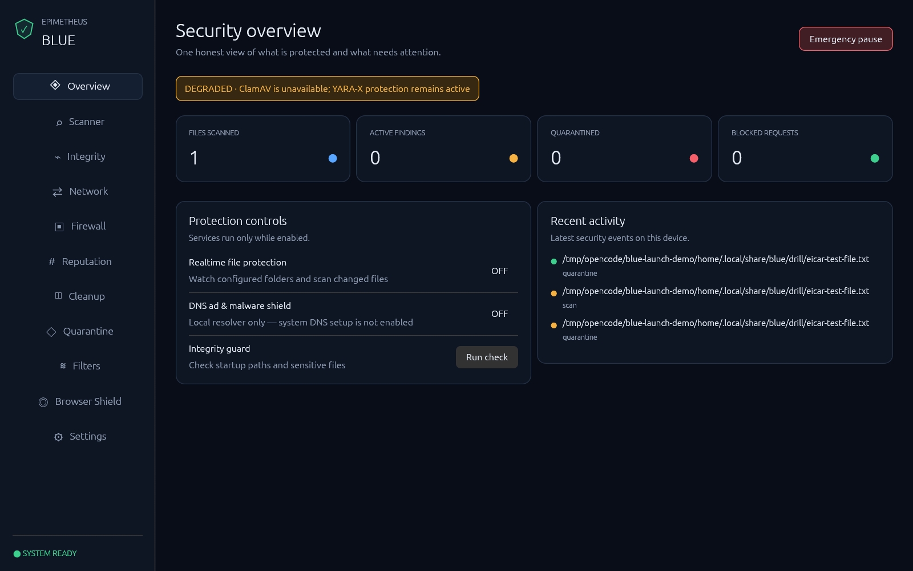
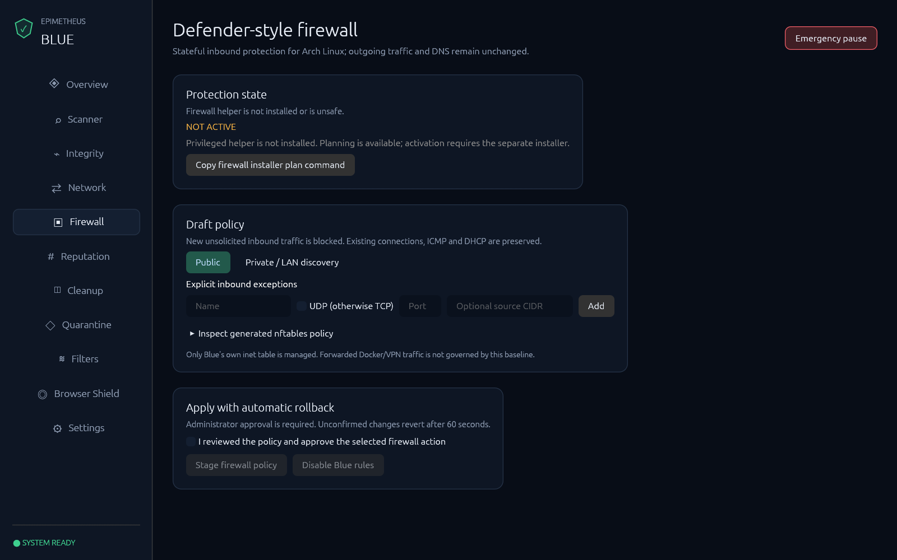
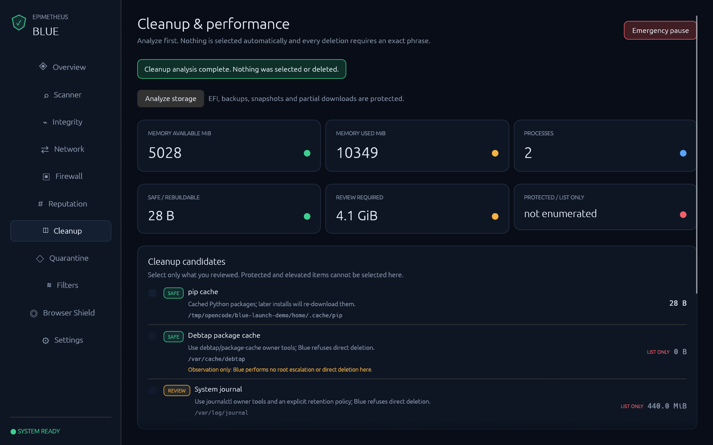

# Epimetheus Blue

**A native, open-source security center for Arch Linux.**

Antivirus integration, staged firewall controls, browser protection, integrity
monitoring and approval-gated cleanup—without Electron or a local web dashboard.

> **Experimental prerelease.** Not independently audited, not a guarantee against
> malware, and not Microsoft Defender detection parity. Test on a non-critical
> machine first. Firewall, system DNS and cleanup are never activated by install.

[Download v0.5.0](https://github.com/paarthbhatt/epimetheus-blue/releases/tag/v0.5.0)
· [Install / uninstall](docs/INSTALL.md)
· [Limitations](docs/LIMITATIONS.md)
· [Report a vulnerability privately](SECURITY.md)



*Actual application capture using isolated demonstration data—not a real infection.*

## What you get

| Area | What Blue does |
|---|---|
| Antivirus | ClamAV + YARA-X integration and reversible, evidence-tiered quarantine |
| Firewall | Stateful IPv4/IPv6 inbound profiles, port/CIDR exceptions and 60-second staged rollback |
| Browser | Chromium/Brave search cleanup, tracker rules and a read-only desktop bridge |
| Integrity | Startup-path and sensitive-file baselines with reviewable changes |
| Reputation | Local SHA-256 IOCs; optional, explicitly configured hash-only VirusTotal |
| Cleanup | Safe/review/protected classifications, manual selection and exact confirmation |
| Network | Read-only egress observation—not per-app outbound enforcement |

## Try it

Download the x86_64 archive and `SHA256SUMS` from the prerelease, then verify:

```bash
sha256sum --ignore-missing -c SHA256SUMS
tar -xzf epimetheus-blue-0.5.0-linux-x86_64.tar.gz
cd epimetheus-blue-0.5.0
./scripts/install-release.sh
~/.local/bin/blue
```

Install is user-local and does not require sudo. ClamAV and the privileged firewall
helper are separate opt-ins. Current Arch Linux, a graphical session, and systemd
are required. See the [installation guide](docs/INSTALL.md) for dependencies.

### Prefer building from source?

```bash
git clone https://github.com/paarthbhatt/epimetheus-blue.git
cd epimetheus-blue
./scripts/install-local.sh
```

Rust 1.95+ is required. A `PKGBUILD` and a tested pacman package are supplied in the
release; review them and follow the [package instructions](docs/INSTALL.md#option-a-pacman-managed-arch-package).
**No AUR listing has been submitted yet.**

## A harmless one-minute demo

```bash
blue verify
blue drill
blue firewall plan --profile public
```

The EICAR drill detects, quarantines and restores a harmless standard test file.
The firewall command only prints a plan. Neither command activates firewall rules
or system DNS. [Detailed usage](docs/USAGE.md) covers optional modules and cleanup.

<details>
<summary>Firewall and cleanup screenshots</summary>





Demo state only. Firewall is not activated; no real files are cleaned.
</details>

## Trust and contributing

- Source is MIT-licensed; third-party engines and feeds retain their own licenses.
- No remote code, analytics or file uploads. Optional VirusTotal sends hashes.
- [Known limits](docs/LIMITATIONS.md) and [architecture](docs/DESIGN.md) are explicit.
- [Contributions and review](CONTRIBUTING.md) welcome—especially privileged-helper
  and cleanup security review. Public bug reports must omit credentials and private data.

See [release notes](docs/RELEASE-v0.5.0.md) and [security policy](SECURITY.md).
